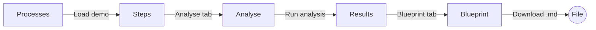
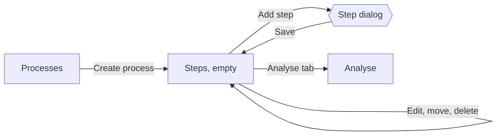
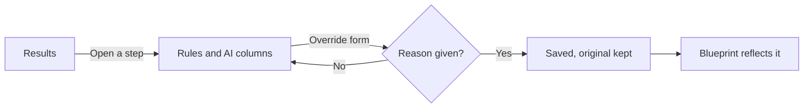

# 01 Discovery

First step of the design process in ADR 0013: who uses the client, what they need to get done, and what the current client (`web/`) already shows. The next documents build on this one.

## Roles and their jobs

From PDR 002. Each job reads "when ..., I want to ..., so I can ...".

| Role | Main job | What success looks like |
|---|---|---|
| Operations lead | When I own a process that eats hours, I want to see which steps are worth automating and how, so I can defend a budget with numbers | Can explain where every figure comes from, and which parts came from the rules and which from the AI |
| Demo visitor | When I review this project, I want to try it end to end in a few minutes, so I can judge the engineering without installing anything | Reaches a business case and a blueprint from a demo without reading docs |
| Maintainer | When the demo is public, I want visitors warned and their data kept short-lived, so I can run it safely | The public demo banner shows on every page |

**Design hypotheses** (to check in the usability sessions, not backlog items):

- A demo visitor reaches the results of a demo analysis in under three minutes and four clicks.
- An operations lead can tell rules output from AI output on every step without help.
- Nobody reads an unknown figure as zero.

## Objects

The client shows six objects. Everything on screen belongs to one of them.

| Object | Key content | Changed by the user |
|---|---|---|
| Process | name, owner, description, executions per month, hourly cost, version | Yes |
| Step | position, name, role, minutes, occurrence and exception rates, five levels (repetitiveness, rule clarity, criticality, input type, integration), tools, three flags (judgement, approval, sensitive data) | Yes, and reorder |
| Analysis | provenance (id, date, process version, rules version, LLM status, prompt version), current state, four panels | Created, never edited |
| Step assessment | rules method and score factors, AI suggestion, final method, human control and source | Through an override |
| Override | new method or control, required reason, original values kept | Created |
| Blueprint | eight sections derived from an analysis, Markdown download | Read only |

## Functional scope

What the new client must let people do, taken from the current client. The table lists capabilities, not layouts: the new screens are sketched from a blank page in `02-ia-wireframes.md`, without opening `web/` first, so the old layout does not anchor the new one.

| Current route | Purpose | Content to show | Actions | Backlog |
|---|---|---|---|---|
| `#/processes` | Start here | Hero, demo cards, new process form, process table | Load demo, create process | RS-73 |
| `#/processes/{id}` (Steps) | Describe the process | Header with tabs, four metrics, step list, process settings | Add, edit (dialog), move up or down, delete step; save or delete process | RS-73, RS-74, RS-91 |
| `#/processes/{id}/analyse` | Set assumptions and run | Implementation and tooling cost, a time reduction slider per step, LLM option, sensitive data gate | Run analysis | RS-75 |
| `#/analyses/{id}` (Results) | Read the analysis | Provenance, current state, four panels (suitability, impact, risk, controls), expandable step assessments | Override a step | RS-92, RS-76 |
| `#/analyses/{id}/blueprint` | Take the result away | Eight numbered sections | Download `.md` | RS-94 |
| `#/processes/{id}/history` | Compare runs | Table of immutable analyses | Open one | RS-93 |

Shared across pages: sidebar with the process list, public demo banner, toast (`role=status`), modal dialog for the step form, skip link, field errors from 422 answers.

## Critical paths

### A. Demo to blueprint (demo visitor)

### B. Describe a process (operations lead)

### C. Disagree with a recommendation (operations lead)

## Constraints the design must keep

These come from ADRs and hard rules, so no layout may break them.

1. **The client never computes a figure** (ADR 0001, hard rule 7). The design shows numbers as the API returns them, formatted by one module. No totals, averages or charts derived in the browser.
2. **Unknown is never zero.** A missing hourly cost leaves cost, savings, payback and ROI as "unknown", and that must look different from a value.
3. **Four panels, never one score** (RS-53). Suitability, impact, risk and controls stay separate. No combined grade, traffic light or ranking across them.
4. **Authority is visible.** System facts, user-confirmed values and LLM suggestions must be distinguishable at a glance, and so must an override from the original.
5. **The LLM can raise a control, never lower one.** The UI must not offer an action that suggests otherwise.
6. **Sensitive data gate** (RS-54). With the LLM on and sensitive steps present, running stays disabled until the user confirms.
7. **Public demo banner** on every page while `public_demo` is true.
8. **Accessibility target** of ADR 0013: WCAG 2.2 AA, keyboard, visible focus, 375 px.

## Next

`02-ia-wireframes.md` sketches each screen from this document alone, starting with a worked example of the home page. The heuristic evaluation comes after the sketches and compares the old client with the new wireframes.

## Open questions for the Product Owner

- Should History stay a tab, or move to a panel on Results?
- Is mobile (375 px) a full-use target for every page, or read-only for Results and Blueprint?
